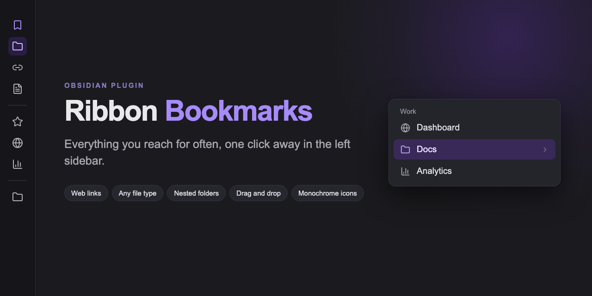

[](https://github.com/bryanmongesolano/obsidian-ribbon-bookmarks/releases)
[](https://community.obsidian.md/plugins/ribbon-bookmarks)
[](LICENSE)



Everything you reach for often, one click away in the left sidebar.

## Features

- **Web links and any file type** — notes, PDFs, canvas, Excalidraw, Office documents, video, audio and archives.
- **Nested folders** — drop an item on another to group them. Folders open in cascading side menus and nest without limit.
- **Drag and drop** — drag a tab, a link, or files and folders straight onto the ribbon.
- **Flat monochrome icons** — Lucide, built-in brand logos, an online SVG search, or your own `.svg` files, always tinted by the current theme.
- **No lock-in** — it opens links in whichever browser is already enabled in the vault, and follows whatever tab behavior you have configured.

## Installation

**From the community directory**

[](https://obsidian.md/plugins?id=ribbon-bookmarks)

**With BRAT** — for testing a version that is not in the directory yet:

1. Install [BRAT](https://github.com/TfTHacker/obsidian42-brat) and run **BRAT: Add a beta plugin for testing**.
2. Enter `bryanmongesolano/obsidian-ribbon-bookmarks`.

**Manually** — copy `main.js`, `manifest.json` and `styles.css` from the [latest release](https://github.com/bryanmongesolano/obsidian-ribbon-bookmarks/releases/latest) into `.obsidian/plugins/ribbon-bookmarks/`.

## Usage

| Action | Result |
| --- | --- |
| Left click | Opens the item |
| Middle click | Opens it in a new tab |
| Left click a folder | Shows its contents |
| Right click the ribbon | Add an item or a separator, plus the native ribbon options |
| Right click an item | Open in new tab, open externally, modify, delete |
| Drag onto another item | Groups them into a folder |
| Drag between two items | Reorders, with a line showing where it will land |

## Settings

Language: automatic (follows the app), English or Spanish.

## Compatibility

- Requires **Obsidian 1.13.0** or later.
- Tab behavior and browser rendering are inherited from the vault: Surfing → Web viewer → system browser, and **Open Tab Settings** when it is installed.
- No telemetry. The only network requests are the optional icon search and the site logo lookup, both started by you.

## Development

```bash
npm install
npm run dev      # watch build
npm run lint     # ESLint + Stylelint with Obsidian's official rules
npm run build    # type check + production build
npm run deploy   # build, then copy into a local vault
```

`npm run deploy` needs the target vault:

```bash
OBSIDIAN_VAULT_PLUGINS="/path/to/vault/.obsidian/plugins" npm run deploy
```

## License

[MIT](LICENSE)
